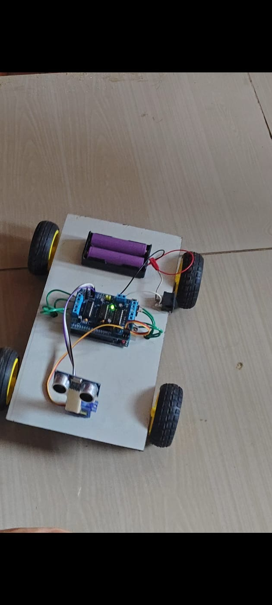

# Smart Path Finding Obstacle Detection Bot

An Arduino-based robot car that detects obstacles with an ultrasonic sensor and finds a clear path to keep moving.

## How it works
1. The HC-SR04 ultrasonic sensor measures the distance ahead.
2. While the path is clear, the bot drives forward.
3. If an obstacle is closer than 25 cm, the bot stops and reverses slightly.
4. The servo rotates the sensor to the left and right to scan.
5. The bot turns toward the side with more free space and continues.

## Components
| Component | Quantity |
|---|---|
| Arduino Uno | 1 |
| L293D motor driver shield | 1 |
| HC-SR04 ultrasonic sensor | 1 |
| Micro servo (SG90) | 1 |
| DC gear motors with wheels | 4 |
| 18650 Li-ion cells with holder | 2 |
| Power switch | 1 |
| Chassis, jumper wires | - |

## Pin connections
| Part | Pin |
|---|---|
| Ultrasonic Trig | A0 |
| Ultrasonic Echo | A1 |
| Servo signal | 10 (SERVO_1 header) |
| Motors | M1, M2, M3, M4 |

> Update this table if your wiring is different.

## Setup
1. Install the [Arduino IDE](https://www.arduino.cc/en/software).
2. Install the **Adafruit Motor Shield V1 Library** (AFMotor) from the Library Manager. `Servo` is built in.
3. Open `code/obstacle_bot.ino`, select **Arduino Uno** and your port, then upload.
4. Switch on the battery pack and place the bot on the floor.

## Tuning
- `STOP_DISTANCE`: obstacle distance (cm) that triggers avoidance.
- `SPEED`: motor speed (0-255).
- `TURN_TIME`: how long the bot turns (ms).
- If it turns the wrong way, swap `FORWARD`/`BACKWARD` in `turnLeft()` and `turnRight()`.

## Future improvements
- Remember visited paths for true path planning
- Bluetooth / mobile app control
- Speed control based on distance

## Author
Your Name - [GitHub profile link]

## License
MIT License
